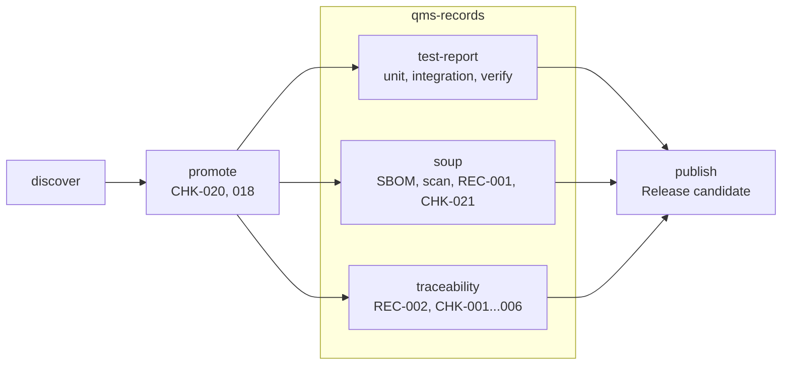
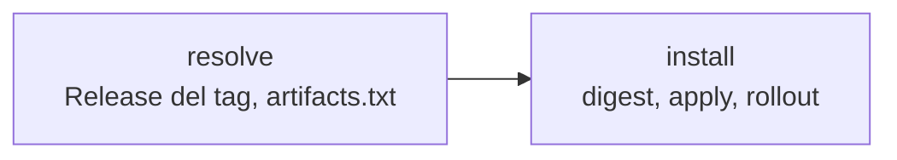

# Flusso CD del prodotto

Due flussi, uno dopo l'altro, sugli artefatti che la [CI](ci.md) ha pubblicato da `main`:

| Flusso | Quando parte | Stazioni |
|---|---|---|
| [Release](#release) | push di un tag `<prefix>-vX.Y.Z` | `discover` → `promote` → `qms-records` → `publish` |
| [Deploy](#deploy) | a mano, sul tag, con la Release pubblicata | `resolve` → `install` |

## Release

Parte al push di un tag `<prefix>-vX.Y.Z` (prefisso `tag` di `product.yaml`), dal `release.yml` del
prodotto. Quattro job, come per la CI uno per stazione. Dopo `promote`, `qms-records` produce le
registrazioni con tre job in parallelo. Non c'è build e non c'è installazione, che è un flusso a parte
([deploy](#deploy)): ritrova gli artefatti che la [CI](ci.md) ha pubblicato da `main` per il commit
taggato, ci aggiunge il tag di versione e produce le registrazioni da allegare al documento di messa in
esercizio (HE-TPL-006 par. 12).



Le registrazioni non sono solo allegati: `qms-records` è anche l'ultimo controllo prima della Release.
`soup` (CHK-021) e `traceability` (CHK-001...006) controllano ciò che si vede solo al tag; un loro
errore ferma `release` prima che la Release esista. Corretta la causa (lista SOUP, documenti Linear,
issue), basta rilanciare i job falliti dello stesso run.

Una release non è una messa in esercizio (HE-SOP-004 par. 4.1, DEC-023): la Release si chiama `candidate <tag>` ed è
una prerelease. La messa in esercizio è il documento HE-TPL-006 firmato, con questi allegati, su Drive.

### `release.yml` del prodotto

Ogni stazione è un workflow riusabile. `promote` restituisce `ci-run-id`, il run `ci` da cui le altre
stazioni recuperano le prove; gli artifact `evidence-*` passano da una stazione all'altra dentro lo
stesso run di `release`. Ogni job concede solo i permessi della sua stazione.

```yaml
name: release
on:
  push:
    tags: ["so-ulss2-v*"]

permissions: {}

jobs:
  discover:
    uses: H-EALTH/shared-workflows/.github/workflows/discover.yml@v0.0.1
    permissions: { contents: read }

  promote:
    needs: discover
    uses: H-EALTH/shared-workflows/.github/workflows/promote.yml@v0.0.1
    permissions: { contents: read, packages: write, actions: read }
    with:
      components: ${{ needs.discover.outputs.components }}
      product: ${{ needs.discover.outputs.product }}

  qms-records:
    needs: [discover, promote]
    uses: H-EALTH/shared-workflows/.github/workflows/qms-records.yml@v0.0.1
    permissions: { contents: read, actions: read, pull-requests: read }
    with:
      components: ${{ needs.discover.outputs.components }}
      product: ${{ needs.discover.outputs.product }}
      ci-run-id: ${{ needs.promote.outputs.ci-run-id }}
    secrets:
      LINEAR_API_KEY: ${{ secrets.LINEAR_API_KEY }}

  publish:
    needs: [discover, promote, qms-records]
    uses: H-EALTH/shared-workflows/.github/workflows/publish.yml@v0.0.1
    permissions: { contents: write, actions: read, pull-requests: read }
    with:
      product: ${{ needs.discover.outputs.product }}
      ci-run-id: ${{ needs.promote.outputs.ci-run-id }}
```

Se il workflow di CI del prodotto non si chiama `ci.yml`, `promote` riceve anche `ci-workflow`.

### Prerequisiti di release

- il commit taggato è su `main` e ha un run `ci` verde su `main` (quindi `build` ed `verify` eseguiti);
- `docs/<PROD>-REC-001_Lista-SOUP.csv` committata e allineata alle dipendenze (CHK-021);
- nel progetto Linear esistono i documenti **User Need** e **Requisiti** nei formati di HE-SOP-003 par. 1;
- il secret `LINEAR_API_KEY` del repository.

### Creare il tag

- da riga di comando: `git tag so-ulss2-v1.2.0 && git push origin so-ulss2-v1.2.0`;
- dalla UI: **Releases → Draft a new release → Create new tag**, target `main`. Il workflow completa la
  Release già creata invece di crearne una nuova.

Altre forme (`v1.2.0`, `so-ulss2-1.2.0`, un prefisso diverso) fanno fallire `promote`. Ultima cifra per
le correzioni, seconda per le funzionalità, prima per le modifiche incompatibili. Un tag non si sposta e
non si cancella (HE-SOP-004 par. 2.3).

## Deploy

Si lancia a mano su un tag `<prefix>-vX.Y.Z`, dal `deploy.yml` del prodotto, dopo che [release](#release)
ha pubblicato la Release del tag. Due job, uno per stazione: `resolve` ritrova la versione candidata,
`install` la mette sul cluster Kubernetes di sviluppo. Non c'è build e non c'è nessun controllo rifatto:
si installano per digest le stesse immagini che la [CI](ci.md) ha provato e `promote` ha taggato.



| Stazione | Dove gira | Cosa fa | Fallisce se |
|---|---|---|---|
| `resolve` | runner di GitHub | scarica `artifacts.txt` dalla Release del tag e restituisce `images` (lista di `ref@digest`) | il ref non è un tag, la Release non c'è o è in bozza, manca `artifacts.txt` |
| `install` | runner self-hosted nel cluster | fissa i digest nell'overlay, `kubectl apply`, attende il rollout | un componente non è nei manifest, l'apply fallisce, il rollout non finisce entro `timeout` |

`resolve` legge la Release e non il run `ci`: gli allegati di una Release non scadono, gli artifact
della CI dopo 90 giorni sì. Non ricontrolla tag e componenti, perché la Release esiste solo se `promote`
e `qms-records` sono passati.

Installare sul cluster di sviluppo non è una messa in esercizio (HE-SOP-004 par. 4.1).

### `deploy.yml` del prodotto

```yaml
name: deploy
on: workflow_dispatch

permissions: {}

jobs:
  resolve:
    uses: H-EALTH/shared-workflows/.github/workflows/resolve.yml@v0.0.1
    permissions: { contents: read }

  install:
    needs: resolve
    uses: H-EALTH/shared-workflows/.github/workflows/install.yml@v0.0.1
    permissions: { contents: read }
    with:
      images: ${{ needs.resolve.outputs.images }}
      runner: dev-cluster
```

`install` accetta anche `overlay` (default `deploy/dev`) e `timeout` (secondi di attesa del rollout di
ogni workload, default 300).

### Lanciare il deploy

- da riga di comando: `gh workflow run deploy.yml --ref so-ulss2-v1.2.0`;
- dalla UI: **Actions → deploy → Run workflow → Use workflow from → Tags**.

Il tag è il ref del run: si usano il `deploy.yml` e l'overlay di quel tag. La Release è pubblicata con
il `GITHUB_TOKEN`, quindi un trigger `on: release` non partirebbe.

Per tornare indietro si rilancia il deploy sul tag precedente.

### Overlay del prodotto

`deploy/dev/kustomization.yaml` nel repository del prodotto, con il `namespace` e i manifest. Le
immagini dei componenti si scrivono senza tag, `ghcr.io/h-ealth/<repo>/<componente>`: è `install` a
fissarle al digest (`kustomize edit set image`), nel workspace del runner e senza commit. Ogni
componente della versione deve comparire nei manifest, altrimenti `install` fallisce.

```yaml
apiVersion: kustomize.config.k8s.io/v1beta1
kind: Kustomization
namespace: so-ulss2-dev
resources:
  - api.yaml
  - worker.yaml
```

### Prerequisiti del deploy

- la Release `candidate <tag>` pubblicata da `release`;
- un runner self-hosted registrato sul repository (o sull'organizzazione) con l'etichetta passata in
  `runner`, dentro il cluster o sul server: si collega lui a GitHub, il cluster non espone nulla;
- sul runner: `kubectl`, `kustomize`, `jq`; `kubectl` già autorizzato sul namespace del prodotto
  (ServiceAccount con un Role limitato al namespace, non `cluster-admin`). Nessun kubeconfig nei secret
  di GitHub;
- nel namespace un `imagePullSecret` per GHCR (token con `read:packages`), citato dai manifest: i
  package sono privati.
