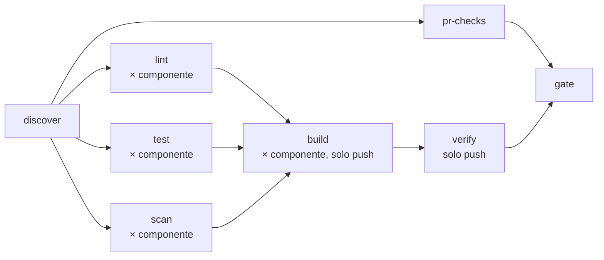

# Flusso CI del prodotto

Parte su ogni pull request verso `dev` e `main` e su ogni push su `dev` e `main`, dal `ci.yml` del
prodotto. Sette job più il gate. Dopo `discover`,
`pr-checks`, `lint`, `test` e `scan` partono in parallelo; `build` ed `verify` solo su push.



## Manifest

### `product.yaml`, nella radice

```yaml
codice: SO                                   # prefisso dei documenti QMS: SO-ARC-001, SO-REC-001, SO-REC-002
tag: so-ulss2                                # prefisso del tag: so-ulss2-vX.Y.Z (HE-SOP-004 par. 2.1)
copertura_minima: 80                         # soglia di test.yml, in percento (HE-TPL-003 par. 4)
linear_progetto: "Sale Operatorie — Pilota ULSS2"   # progetto Linear con i documenti User Need e Requisiti
```

Quattro chiavi, tutte obbligatorie, nessun'altra. `linear_progetto` accetta il nome esatto, lo slug o
l'id del progetto.

### `component.yaml`, in ogni cartella componente

```yaml
kind: python     # python | node
arc: ARC-002     # codice del componente in docs/architecture/<codice>-ARC-001.md
```

- `kind` sceglie i passi di `lint` e `test` e i file obbligatori (tabella sotto).
- `arc` deve essere la prima cella di una riga della tabella dei componenti di
  `docs/architecture/<codice>-ARC-001.md`, copia nel repository della tabella di HE-TPL-018 par. 2
  (l'originale controllato resta su Drive). Lo stesso file serve a `pr-checks` e `qms-records` per i
  nomi `test_arc_nnn_...`.
- Il nome del componente è il nome della cartella: minuscolo, unico, è anche il nome dell'immagine.

| `kind` | lint | test | File obbligatori |
|---|---|---|---|
| `python` | `ruff check`, `ruff format --check`, `mypy .` | `pytest tests/unit tests/integration` con `--cov-fail-under` | `Dockerfile`, `pyproject.toml`, `requirements-dev.txt` (ruff, mypy, pytest, pytest-cov) |
| `node` | `npm run lint`, `npm run typecheck` | `npm test -- tests/unit tests/integration` (vitest run, `@vitest/coverage-v8`) | `Dockerfile`, `package.json`, `package-lock.json` |

In `pyproject.toml` conviene `[tool.coverage.run] omit = ["tests/*"]`, altrimenti i test contano nella
copertura.

