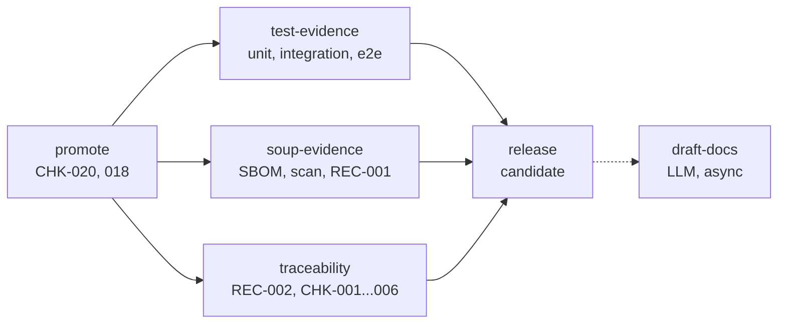

# Flusso di rilascio del prodotto

Parte al push di un tag `<prefix>-vX.Y.Z` (prefisso `tag` di `product.yaml`), dal `release.yml` del
prodotto ([scaffold](../scaffold/.github/workflows/release.yml)). Cinque job. Dopo `promote`, le tre
stazioni di evidenza partono in parallelo. Non c'è build, non c'è deploy: ritrova gli artefatti che la
[CI](ci.md) ha pubblicato da `main` per il commit taggato, ci aggiunge il tag di versione e produce le
registrazioni da allegare al documento di messa in esercizio (HE-TPL-006 par. 12).

Un tag non è una messa in esercizio (HE-SOP-004 par. 4.1): la Release si chiama `candidate <tag>` ed è
una prerelease. La messa in esercizio è il documento HE-TPL-006 firmato, con questi allegati, su Drive.

## Prerequisiti

- il commit taggato è su `main` e ha un run `ci` verde su `main` (quindi `build` ed `e2e` eseguiti);
- `docs/<PROD>-REC-001_Lista-SOUP.csv` committata e allineata alle dipendenze (CHK-021);
- nel progetto Linear esistono i documenti **User Need** e **Requisiti** nei formati di HE-SOP-003 par. 1;
- il secret `LINEAR_API_KEY` del repository.

## Creare il tag

- da riga di comando: `git tag so-ulss2-v1.2.0 && git push origin so-ulss2-v1.2.0`;
- dalla UI: **Releases → Draft a new release → Create new tag**, target `main`. Il workflow completa la
  Release già creata invece di crearne una nuova.

Altre forme (`v1.2.0`, `so-ulss2-1.2.0`, un prefisso diverso) fanno fallire `promote`. Ultima cifra per
le correzioni, seconda per le funzionalità, prima per le modifiche incompatibili. Un tag non si sposta e
non si cancella (HE-SOP-004 par. 2.3).

## Job

| Job | Cosa fa | Output | Controlli |
|---|---|---|---|
| `promote` | verifica il tag (formato, su `main`, run `ci` verde); scarica `artifacts.txt` di quel run; aggiunge il tag di versione agli stessi digest su GHCR (`imagetools create`), senza ricostruire; SBOM dei digest taggati | `artifacts.txt`, `sbom-<comp>.spdx.json` (allegato 4) | CHK-020, 018, H-94 |
| `test-evidence` | scarica `test-<comp>` ed `e2e` del run `ci`; fonde i JUnit in una tabella (test, componente, livello, esito, durata, codice); copertura per componente; fallisce se manca un JUnit o se un test non è superato | `test-report.csv` (allegato 1), `coverage.csv` | HE-SOP-005 par. 3.3 |
| `soup-evidence` | scarica `scan-<comp>` e `scan-<comp>-image`; dai Dockerfile, requirements, pyproject, package.json e dalla SBOM genera nome, produttore e versione di ogni dipendenza diretta; confronta con `docs/<PROD>-REC-001_Lista-SOUP.csv` (blocca se divergono); differenza rispetto al tag precedente | `scan-report.csv` (allegato 5), `<PROD>-REC-001_Lista-SOUP.csv` aggiornata nelle colonne deterministiche, `soup-diff.csv` (HE-TPL-006 par. 6) | CHK-021, HE-SOP-004 par. 3.1 |
| `traceability` | legge da Linear i documenti User Need e Requisiti e le issue con le sotto-issue; da GitHub le PR fuse con `Closes` / `Part of`; dai JUnit i nomi dei test; da `docs/` i rapporti HE-TPL-024; costruisce le 13 colonne di HE-SOP-003 par. 5; congela i due export | `<PROD>-REC-002_Matrice-tracciabilita.csv` (allegato 2), `UserNeed_<PROD>_<data>.md`, `Requisiti_<PROD>_<data>.md` | CHK-001, 002, 003, 004, 006 |
| `release` | crea (o completa) la Release «candidate <tag>» con le PR fuse dal tag precedente, autore e approvatori; allega tutti gli output, singolarmente e in `bundle-<tag>.zip` | `pull-requests.csv` (allegato 3), `bundle-<tag>.zip` | HE-TPL-006 par. 12 |

Il prodotto chiama `release.yml` con `contents: write`, `packages: write`, `actions: read`,
`pull-requests: read`: un workflow chiamato non può avere più permessi di chi lo chiama.

### La lista SOUP

La pipeline genera il punto 1 di HE-SOP-004 par. 3.1 (nome, produttore, versione) dalle dipendenze
**dirette**: `FROM` dei Dockerfile, `requirements.txt` e `[project].dependencies` di `pyproject.toml`,
`dependencies` di `package.json` (versioni da `package-lock.json`), con la SBOM dell'immagine per le
versioni non pinnate e i produttori. Le transitive non entrano (sono coperte dal componente che le
richiama). Il confronto con la lista committata è per nome (minuscolo, prima della parentesi, `_` come
`-`): una dipendenza senza riga blocca, una riga senza dipendenza blocca; le righe con versione
`DA DEFINIRE` o vuota sono segnaposto e non contano. La lista aggiornata nel bundle ha versione e
produttore ricalcolati e le righe mancanti aggiunte vuote: si copia nel repository e su Drive e si
compilano i punti 2-7 a mano.

### La matrice

Colonne fisse: `user_need`, `requisito`, `arc`, `issue`, `pull_request`, `componente_codice`, `test`,
`esito_test`, `rsk`, `rc`, `verifica_misura_rischio`, `versione_rilascio`, `note`. Una riga per coppia
(requisito, test), una per requisito senza test, una per test di integrazione (`test_arc_nnn`).
`componente_codice` è la cartella del componente che contiene il test (`sistema` per `tests/system`,
`manuale` per i rapporti HE-TPL-024). I test di unità non entrano (HE-SOP-003 par. 5).

Fonti e formati letti, senza interpretazione:

- documento **Requisiti**: tabella con codice `REQ-nnn`, testo, User Need, `ARC-`, `RC-`, stato; i
  requisiti `superato` non contano;
- documento **User Need**: tabella con numero, testo, data, recap, stato;
- **issue madre**: piè `User Need: 4 · Requisiti: REQ-012, REQ-013` oppure `Verifica: REQ-012, RC-07`;
  senza piè, i codici della sezione «Criteri di accettazione»; le issue `Tipo: Attività` non entrano;
- **sotto-issue**: figlie della madre; la PR le cita con `Closes H-n` / `Part of H-n`;
- **test**: `test_req_nnn_...` in `tests/system`, `test_arc_nnn_...` in `tests/integration`;
- **rapporti HE-TPL-024** in `docs/`: file `Prova_*.md` la cui riga «Prodotto e versione provata» cita
  il tag, la versione x.y.z o il commit; colonna «Requisito (codice)» ed «Esito» del par. 2. Le prove
  manuali si eseguono sulle immagini `sha-<short>` di `main` prima di taggare, citando il commit.

| Controllo | Fallisce se |
|---|---|
| CHK-001 | una issue o un test cita un codice `REQ-` o `ARC-` che non esiste |
| CHK-002 | un requisito attivo non ha un test superato (automatico o manuale) |
| CHK-003 | un test di integrazione o di sistema non ha un codice nel nome |
| CHK-004 | un requisito con `RC-` non ha un test superato che ne verifichi l'efficacia |
| CHK-006 | una sotto-issue chiusa non ha una PR, o la madre è fuori dal progetto |

## Allegati della Release

| Allegato di HE-TPL-006 | File |
|---|---|
| 1, rapporto dei test | `test-report.csv`, `coverage.csv` |
| 2, matrice di tracciabilità | `<PROD>-REC-002_Matrice-tracciabilita.csv`, `UserNeed_<PROD>_<data>.md`, `Requisiti_<PROD>_<data>.md` |
| 3, pull request con approvatori | `pull-requests.csv` |
| 4, SBOM | `artifacts.txt`, `sbom-<comp>.spdx.json` |
| 5, scansioni di sicurezza | `scan-report.csv`, `<PROD>-REC-001_Lista-SOUP.csv`, `soup-diff.csv` |
| tutto | `bundle-<tag>.zip` |

La prova dei test è la copia allegata, non il log della pipeline (HE-SOP-005 par. 6).

## draft-docs

Workflow separato ([scaffold](../scaffold/.github/workflows/draft-docs.yml)): parte quando `release` si
conclude con successo (`workflow_run`) o a mano con il tag (`workflow_dispatch`). Non usa
`release: published`: una Release creata con il `GITHUB_TOKEN` non genera eventi che avviano altri
workflow. Mai bloccante, mai asset della Release.

Scarica `bundle-<tag>.zip` ed esegue le skill di [`skills/`](../skills/) con l'API Anthropic (secret
`ANTHROPIC_API_KEY`, modello da input `model`) sul solo contenuto del bundle e dei template di
[`qms/templates/`](../qms/): niente codice, niente dati. Ogni campo che richiede giudizio umano esce come
`[DA COMPILARE: ruolo]`, front-matter `stato: bozza`. Artifact `draft-docs-<tag>`:

| File | Modello | Quando |
|---|---|---|
| `MessaInEsercizio_<prodotto>_<x.y.z>.md` | HE-TPL-006 | sempre |
| `Prova_manuale_<x.y.z>_<data>.md` | HE-TPL-024 | sempre: i casi proposti per le prove che non girano in pipeline |
| `Proposta_<PROD>-DTE-001_<x.y.z>.md` | HE-TPL-022 | se il diff dal tag precedente tocca `infra/`, o alla prima versione |
| `Proposta_<PROD>-IFU-001_<x.y.z>.md` | HE-TPL-021 | se una misura `RC-` è attuata da un requisito toccato da una PR della versione |

Le bozze sono software del sistema di gestione (HE-REC-002): diventano registrazioni solo dopo
compilazione, riesame e firma (HE-SOP-001).

## Quando il rilascio fallisce

| Errore | Causa | Cosa fare |
|---|---|---|
| `tag … non conforme` | prefisso o formato sbagliato | cancellare Release e tag, ricreare con `<prefix>-vX.Y.Z` |
| `il commit … non è su main` | tag su `dev` o su un branch | taggare un commit di `main` |
| `nessun run ci verde su main` | tag creato prima che la CI di `main` fosse verde | cancellare Release e tag, aspettare la CI, ricreare |
| `artifact … non trovati` | commit più vecchio di 90 giorni | rilasciare da un commit recente di `main` |
| `CHK-021: dipendenze senza riga nella lista SOUP` | dipendenza nuova non in `docs/<PROD>-REC-001_Lista-SOUP.csv` | compilare i punti 2-7 nella lista (anche dalla copia aggiornata nel bundle) |
| `CHK-00n` di `traceability` | vedi la tabella sopra | correggere issue, test o rapporti; ritaggare dopo la correzione |
| `allegati non caricati` | Release immutabile | una Release senza prove non è valida: ricreare |
