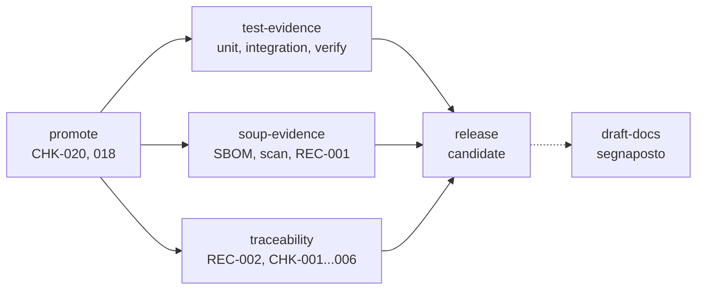

# Flusso di rilascio del prodotto

Parte al push di un tag `<prefix>-vX.Y.Z` (prefisso `tag` di `product.yaml`), dal `release.yml` del
prodotto. Cinque job. Dopo `promote`, le tre
stazioni di evidenza partono in parallelo. Non c'è build, non c'è deploy: ritrova gli artefatti che la
[CI](ci.md) ha pubblicato da `main` per il commit taggato, ci aggiunge il tag di versione e produce le
registrazioni da allegare al documento di messa in esercizio (HE-TPL-006 par. 12).

Un tag non è una messa in esercizio (HE-SOP-004 par. 4.1): la Release si chiama `candidate <tag>` ed è
una prerelease. La messa in esercizio è il documento HE-TPL-006 firmato, con questi allegati, su Drive.

## Prerequisiti

- il commit taggato è su `main` e ha un run `ci` verde su `main` (quindi `build` ed `verify` eseguiti);
- `docs/<PROD>-REC-001_Lista-SOUP.csv` committata e allineata alle dipendenze (CHK-021);
- nel progetto Linear esistono i documenti **User Need** e **Requisiti** nei formati di HE-SOP-003 par. 1;
- il secret `LINEAR_API_KEY` del repository.

## Creare il tag

- da riga di comando: `git tag so-ulss2-v1.2.0 && git push origin so-ulss2-v1.2.0`;
- dalla UI: **Releases → Draft a new release → Create new tag**, target `main`. Il workflow completa la
  Release già creata invece di crearne una nuova.

Altre forme (`v1.2.0`, `so-ulss2-1.2.0`, un prefisso diverso) fanno fallire `promote`. Ultima cifra per
le correzioni, seconda per le funzionalità, prima per le modifiche incompatibili. Un tag non si sposta e
non si cancella (HE-SOP-004 par. 2.3).

