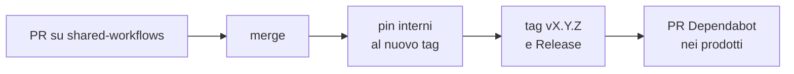

# Flusso di rilascio di `shared-workflows`

Ogni modifica a `shared-workflows` passa da PR (`check.yml`: actionlint, ruff, pytest, pin interni) e
diventa disponibile ai prodotti solo con un tag `vX.Y.Z`. I prodotti adottano la nuova versione con la
PR di Dependabot. La numerazione continua quella di `platform`: la prima versione è `v0.5.0`,
successore di `platform@v0.4.0`.



## Passi

1. PR e merge su `main` di `shared-workflows`.
2. I workflow riusabili chiamano le action con il tag completo, come fanno i prodotti
   (`uses: H-EALTH/shared-workflows/actions/<nome>@vX.Y.Z`, ADR 0003): prima di creare il tag si
   aggiornano quei riferimenti al nuovo tag, in una sola PR:
   `grep -rln 'H-EALTH/shared-workflows/' .github/workflows scaffold docs | xargs sed -i 's/@v0\.5\.0/@v0.6.0/g'`.
   Il riferimento si risolve quando il workflow gira, quindi il tag può citare sé stesso; `check.yml`
   verifica che i pin citino un solo tag.
3. Tag `vX.Y.Z` e Release con le modifiche.
4. Nei prodotti Dependabot aggiorna il tag. Nomi di file, input, permessi, secret e struttura dei job
   vanno aggiornati a mano nella stessa PR, seguendo lo [scaffold](../scaffold/).

## Quale numero

| Cambio | Esempio |
|---|---|
| `patch` | correzione senza cambiare input, output o comportamento |
| `minor` | nuovo input opzionale, nuovo workflow, nuovo output, nuova versione di un template QMS |
| `major` | input rimosso o reso obbligatorio, comportamento che richiede modifiche nei prodotti |

Fino a `1.0.0` un cambio incompatibile può uscire come `minor`. Cambi che hanno richiesto modifiche
manuali nei prodotti:

| Versione | Cambio |
|---|---|
| `platform v0.2.0` ... `v0.3.0` | vedi `platform/docs/versionamento.md` |
| `v0.5.0` | repository `shared-workflows` al posto di `platform`; `product.yaml` (ADR 0008) e chiave `arc` in `component.yaml`; `docs/architecture/<PROD>-ARC-001.md` e `docs/<PROD>-REC-001_Lista-SOUP.csv` nel repository; `verify-*` sostituiti da `lint` e `test` con input `kind` (un job per stazione, non per genere); `image` sostituito da `build` (controlli prima del push, ADR 0009) ed `e2e`; `ci.yml` su `dev` e `main` con `edited`; `release.yml` con input `components` e `product`, secret `LINEAR_API_KEY`, permesso `pull-requests: read`; nuovo `draft-docs.yml`; `.github/PULL_REQUEST_TEMPLATE.md` con la definizione di fatto; branch `dev` |

## Pin delle action

Le action di terze parti sono pinnate allo SHA con il tag in commento, così Dependabot le riconosce;
quelle GitHub-owned (`actions/*`) al tag maggiore (ADR 0003).

```yaml
- uses: docker/login-action@dbcb813823bdd20940b903addbd779551569679f   # v4.6.0
```

## Gli script come software del sistema di gestione

`actions/traceability`, `soup-evidence`, `test-evidence` e `draft-docs` producono o preparano
registrazioni del sistema di gestione: sono software da validare (HE-SOP-003 par. 5, HE-REC-002). La
validazione è `tests/` eseguito da `check.yml` a ogni PR, più il primo rilascio reale confrontato a
mano con la matrice compilata; l'esito si registra in HE-REC-002 con la versione del tag.
